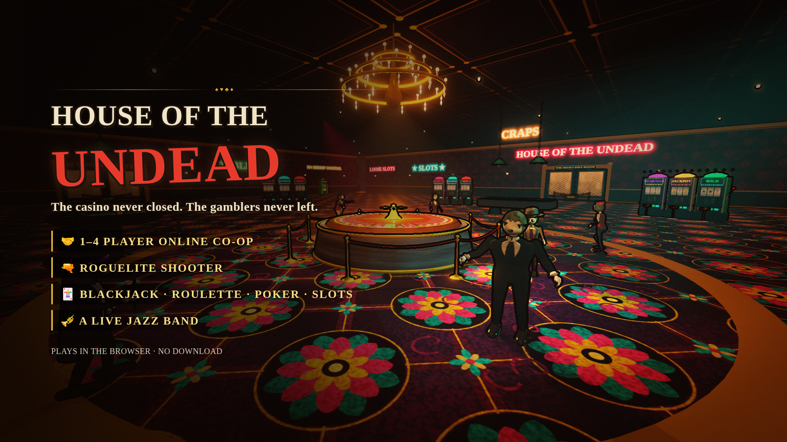

# HOUSE OF THE UNDEAD



A first-person roguelite shooter set in a haunted 1930s Las Vegas casino. Fight the undead gamblers, collect chips, gamble between rounds, and build up your arsenal. The whole game is drawn as a rubber-hose cartoon from the Fleischer and early Disney era.

## 🤖 An AI-Made Game

This game was made with AI. The code, 3D models, textures, animation, music, and sound effects were generated by Claude, an AI model made by Anthropic, through conversations in which I directed the design, tested each build, and asked for changes.

There are no image, model, or audio files in the project. Everything you see and hear is generated by code while the game runs.

## Play

* **Online:** https://cinco-05.github.io/zombiecasino/ (published from `main` by GitHub Pages once Pages is switched on: Settings → Pages → Source: GitHub Actions)
* **Windows:** double-click `HOUSE OF THE UNDEAD.exe`
* **Any browser:** open `HOUSE OF THE UNDEAD.html`
* **From the source folder:**

```powershell
cd HOUSE-OF-THE-UNDEAD
python -m http.server 8000
```

Then open `http://localhost:8000`.

## Controls

New players get a HOW TO PLAY card and short tips the first time each thing comes up. Every key below can be rebound in Settings → Controls (which also has invert Y, and hold or toggle for aiming and sprinting).

* WASD: Move
* Mouse: Aim
* Left click: Fire
* Right click: Aim down sights
* Shift: Sprint
* Space: Jump
* Q: Dash
* G: Lethal
* T: Tactical
* F: Pistol-whip
* R: Reload
* E: Use/buy, and hold to revive a teammate
* 1–3 or mouse wheel: Switch guns
* Esc: Pause, or back out of a menu
* F11: Fullscreen
* F3: Debug panel
* TAB (hold): Scoreboard
* At the tables: H / S / D / P (hit, stand, double, split), 1–5 and Space (poker), Space and 1–3 (slots)

## Main Features

* 10-round campaign and endless mode. Every run is dealt from a seed, and you can type one in to replay it
* Boss fights: The Pit Boss on round 5 and The House Dealer on round 10
* 11 guns, including the Lady Luck wonder weapon, built from three parts won at the tables
* ALL IN, the casino's own pack-a-punch
* 12 enemy types, elites and the Golden Gambler
* Create-a-class at the Coat Check, with lethals, tacticals and vices
* A Balatro-style shop between rounds. Its blackjack (with splits), roulette and five-card draw are played on 3D felt, and LUCKY UNDEAD is a three-reel slot machine that pays back more than it takes. Losing a wager adds penalties to the next round
* Cocktail perks, paid doors to new wings, and the Big Six money wheel
* Streaks, a progressive jackpot, and comps in five rarities
* Permanent progression: the Vault, Loyalty Card tiers, Markers, and collectible chips
* Online co-op for up to four players by room code or invite link: everyone gets their own shop, a downed teammate shows a revive icon (hold E to pick them up), and holding TAB shows everyone's ping, kills, deaths, damage and chips
* One click from the menu to the first fight, first-night tips, a HOW TO PLAY card, and fully rebindable controls
* ASSIST & ACCESS settings: an assist mode (half damage, gentler bets, a once-a-run second chance), aim assist, reduce motion and reduced flashing
* THE EVENING GHOUL: every run ends with its own newspaper front page
* A main-menu title you can play like a xylophone, menu zombies you can poke, and a casino that answers back when you shoot it
* An FPS and ping readout in the corner (ping reads 0 when you play alone)
* Three art styles: 1930s Cartoon, 1930s Black & White, and Modern
* A procedural jazz band playing three tunes in rotation, and 3D audio
* Mid-run saves and local records
* No internet needed after loading, except for co-op

All chips and wagers are fictional and have no real-world value.
